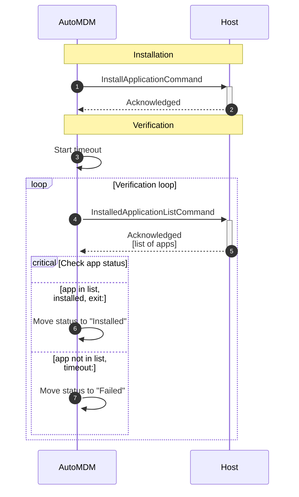
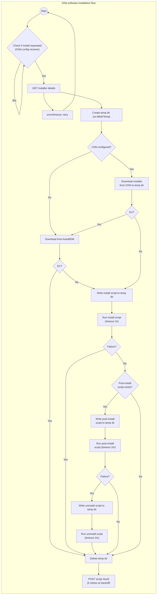
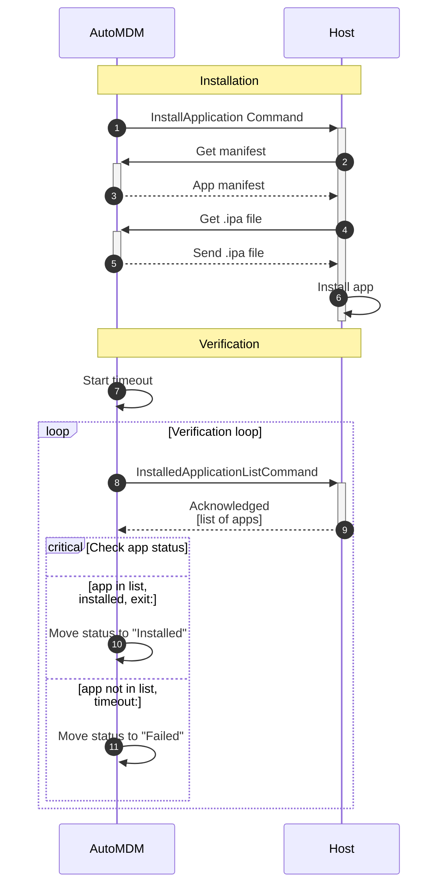

# Software installation architecture

This document provides an overview of AutoMDM's software installation architecture.

## Introduction

Software installation in AutoMDM enables the deployment and installation of software packages across
the device fleet. This document provides insights into the design decisions, system components, and
interactions specific to the Software Installation functionality.

## Important concepts

### Software types

AutoMDM supports 3 different types of installable software: custom packages, AutoMDM-maintained apps,
and app store apps.

#### Custom packages

Custom packages are software packages whose installer is uploaded directly to AutoMDM by an admin.

AutoMDM supports the following installer files as custom packages

| Installer file extension      | Supported platform(s) |
| ----------- | ----------- |
| .pkg   | macOS                  |
| .ipa   | iOS, iPadOS            |
| .msi   | Windows                |
| .exe   | Windows                |
| .deb   | Debian-based Linux     |
| .rpm   | RHEL-based Linux       |

#### AutoMDM-maintained apps

AutoMDM-maintained apps are software that AutoMDM curates. AutoMDM sources installers and generates
install and uninstall scripts for AutoMDM-maintained apps, so that admins can add them to their
software library with just a few clicks.

#### App store apps

App store apps are software that is installed directly from an external app store. AutoMDM currently supports
the Apple App Store (via [VPP](https://developer.apple.com/documentation/devicemanagement/managing-apps-and-books-through-web-services-legacy) apps (for macOS, iOS, and iPadOS hosts)) 
and the Google Play Store (for Android hosts).

## Architecture diagrams

## Installation flows

### VPP app install and verification

VPP apps are installed using the Apple MDM protocol. When an install is triggered, AutoMDM sends an `InstallApplication` command
to the host.

To verify that the install was successful, AutoMDM sends a series of `InstalledApplicationList` MDM commands after
the acknowledgment of the `InstallApplication` command. AutoMDM attempts to verify until either
- the app shows up in the `InstalledApplicationList` response as installed, or
- the verification timeout (defaults to 10m, configurable via the `AUTOMDM_SERVER_VPP_VERIFY_TIMEOUT`
  env var).

### Orbit implementation of installer-based (custom packages, FMA) software install

### In-house (.ipa) app install and verification

In-house apps are installed using the Apple MDM protocol similar to VPP apps. 
- AutoMDM first sends an `InstallApplication` command with a `ManifestURL` key, which contains the AutoMDM `:title_id/in_house_app/manifest` endpoint, instead of an `iTunesStoreID` key.
- The host sends a request to that endpoint to get the manifest, which contains metadata and a download URL which is the `:title_id/in_house_app` endpoint.
- AutoMDM optionally cloudfront signs the download URL.
- The in-house app gets verified the same way as VPP installs, using `InstalledApplicationList`.

### Android app install

Android app installation works a bit differently than on other platforms. AutoMDM uses the Google Android Management API (AMAPI) which
sends one declarative "policy" to devices. When an Android app is added to a team, a job gets triggered to add this app to the policy
on relevant hosts with the InstallType set to "[AVAILABLE](https://developers.google.com/android/management/reference/rest/v1/enterprises.policies#InstallType)". 
For each host, this job will send a request to [enterprises.policies.modifyPolicyApplications](https://developers.google.com/android/management/reference/rest/v1/enterprises.policies/modifyPolicyApplications) which will make the app available for download in the Google Play Store for that host, and record its result in the database.

Setup experience: currently, setup experience will add all relevant apps to a host's policy, 
but with InstallType set to "[PREINSTALLED](https://developers.google.com/android/management/reference/rest/v1/enterprises.policies#InstallType)"
which will automatically install the app on the device.

## Related resources

- [Software product group documentation](README.md) - Documentation for the Software product group
